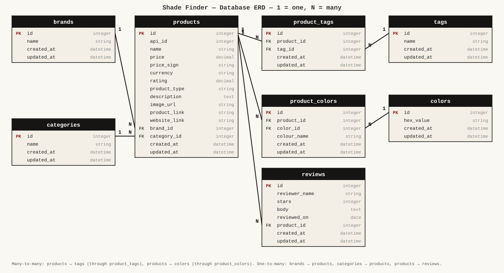

# Shade Finder — Rails Intro Project

A Ruby on Rails app to browse eye makeup (eyeshadows and eyeliners) by brand, category, tag and shade.

## RUBRIC 1.1 — Datasets

| # | Source | Format | What it gives us |
|---|--------|--------|------------------|
| 1 | Makeup API — `https://makeup-api.herokuapp.com/api/v1/products.json?product_type=eyeshadow` | JSON | eyeshadow products |
| 2 | Makeup API — `https://makeup-api.herokuapp.com/api/v1/products.json?product_type=eyeliner` | JSON | eyeliner products |
| 3 | Faker gem | Ruby | fake customer reviews for every product |

**Structure of one API product:** `id, brand, name, price, price_sign, currency, image_link, product_link,
website_link, description (HTML), rating, category, product_type, tag_list [strings],
product_colors [{ hex_value, colour_name }], api_featured_image`.

**How the data is split into tables and related:**

- `brand` string → **brands** (Brand 1 ─ N Product)
- `category` string → **categories** (Category 1 ─ N Product); empty category → "uncategorized"
- each `tag_list` item → **tags**, joined through **product_tags** (Product N ─ N Tag)
- each unique `hex_value` → **colors**, joined through **product_colors** which also keeps `colour_name` (Product N ─ N Color)
- Faker → **reviews** (Product 1 ─ N Review)

Both endpoints share the brands/categories/tags/colors tables, so the eyeshadow and eyeliner datasets are integrated.
The API `id` is stored in `products.api_id`; ActiveRecord creates our own primary keys.

## RUBRIC 1.2 — ERD



## Run it

```bash
bundle install
bin/rails db:migrate
bin/rails db:seed      
bin/rails server
```

